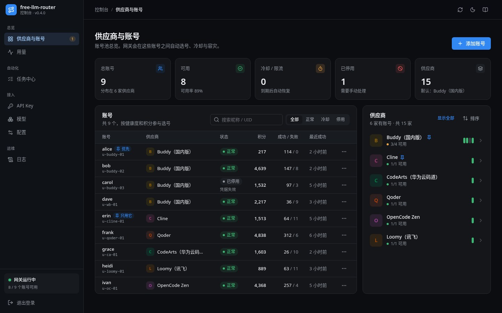
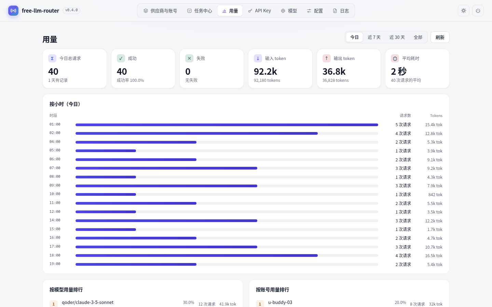
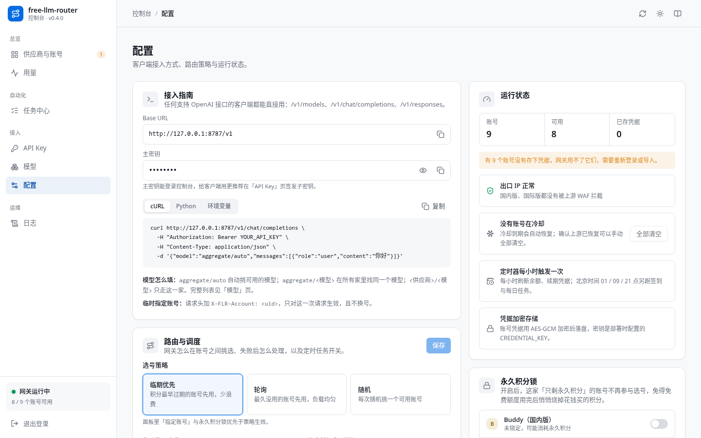
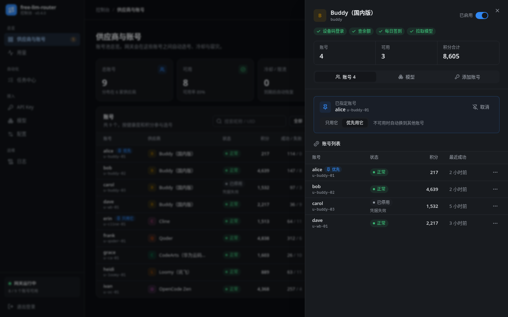
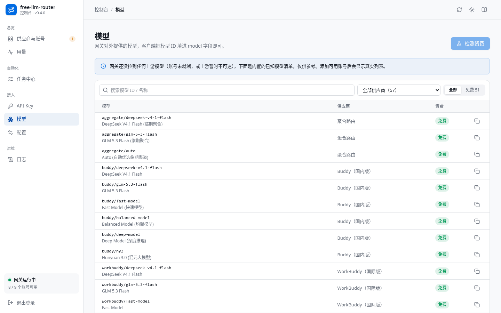
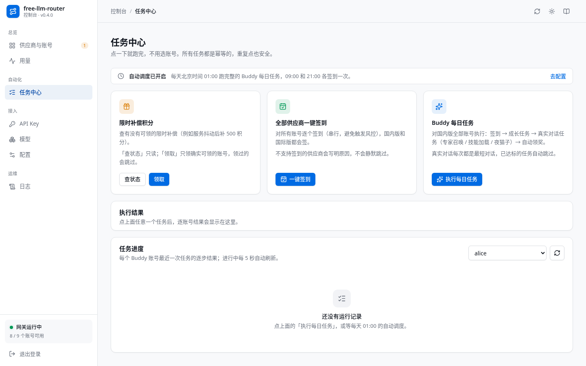
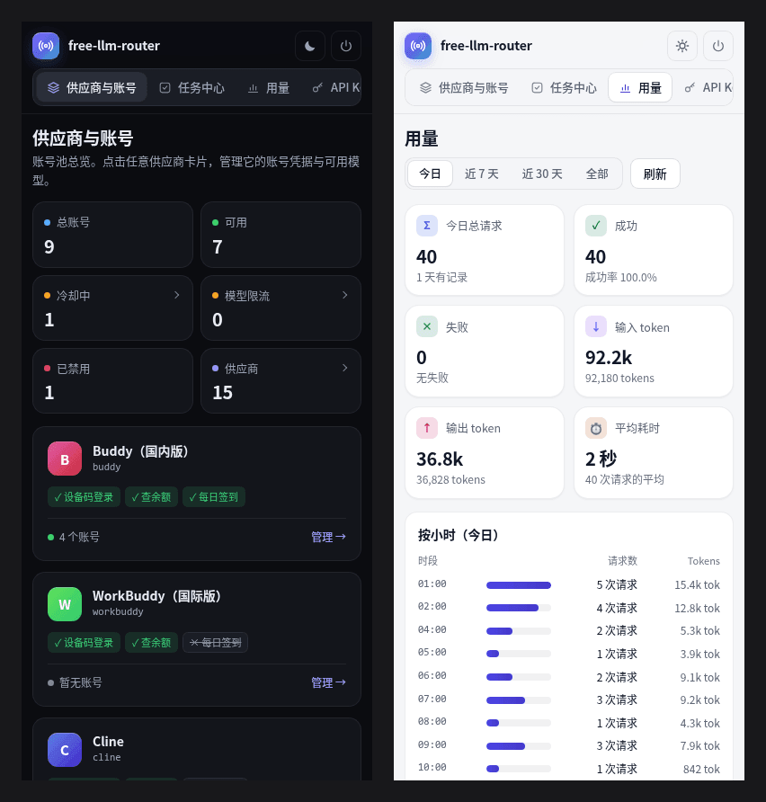

<div align="center">

# free-llm-router

**把多家大模型供应商的账号池，汇成一个 OpenAI 兼容 API。**

自动选号 · 冷却与容灾 · 签到与每日任务自动跑 · 自带管理面板<br>
部署到 Cloudflare Workers，或在 VPS 上跑一个 Node 进程


</div>

> [!WARNING]
> **仅限本人授权的账号自用。** 不支持、也不鼓励批量注册、账号出租或转售 API，详见 [使用边界](#使用边界)。



## 目录

- [特性](#特性)
- [快速开始](#快速开始)
- [接入客户端](#接入客户端)
- [支持的供应商](#支持的供应商)
- [管理面板](#管理面板)
- [工作原理](#工作原理)
- [API 一览](#api-一览)
- [本地开发](#本地开发)
- [已知限制](#已知限制)
- [使用边界](#使用边界)

## 特性

- **一个入口**：`/v1/models`、`/v1/chat/completions`、`/v1/responses`，支持流式、非流式和工具调用。凡是能填自定义 Base URL 的 OpenAI 客户端都能直接接。出站前自动修好客户端常见的请求体问题（工具调用配对断裂、`tool_choice`/`tools`/`stop` 形态不对、DeepSeek 思考模式缺 `reasoning_content` 等），避免上游 400 让整条会话报废。
- **15 家供应商**：Buddy、WorkBuddy、Cline、MiniMax、Qoder、TRAE、ZCode、Loomy、Gemini 等。账号可以在面板里用设备码、扫码、短信登录，也可以粘贴凭据导入，系统会自动识别是哪一家。
- **账号池自动调度**：默认先用积分最早到期的账号。失败时按上游错误类型决定换号、罚号还是只冷却某个模型；国内版账号全部不可用时自动切到国际版。
- **聚合模型**：`aggregate/<模型名>` 把多家的同一个模型归到一起，优先走积分最快作废的渠道，失败自动换下一家。
- **账号自动化**：定时签到、跑每日任务、刷新余额、续期凭据；限时补偿积分可在面板一键领取。
- **子密钥**：给不同工具或设备各发一把 Key，可限制请求数、token 数、可用模型、来源 IP（CIDR）和过期时间。
- **管理面板**：7 个视图，深浅主题，手机可用；不加载任何外部资源，配严格 CSP。
- **部署简单**：Cloudflare Workers 的 Free 计划即可运行；在 VPS 上则是一个约 2.3 MB 的单文件加一个 SQLite 库，不依赖外部数据库。

## 快速开始

### 方式 A：VPS / Node（Docker Compose）

```bash
git clone https://github.com/quancifang44556/free-llm-router.git && cd free-llm-router
npm install --legacy-peer-deps      # 必须带这个参数：wrangler 与 workers-types 的 peer 版本冲突
npm run build:node                  # 产出 dist/server.mjs（已包含管理面板）

echo "API_KEY=$(openssl rand -hex 24)" > .env && cat .env   # 面板与 API 的口令，记下来
mkdir -p data && sudo chown -R 1000:1000 data                # 容器内以 uid 1000 运行
docker compose up -d --build
```

不用 Docker 的话，直接运行 `node --env-file=.env dist/server.mjs`（需要 Node.js ≥ 22.13）。

### 方式 B：Cloudflare Workers

```bash
git clone https://github.com/quancifang44556/free-llm-router.git && cd free-llm-router
npm install --legacy-peer-deps
npx wrangler login
npm run deploy

KEY=$(openssl rand -hex 24); echo "API_KEY=$KEY"             # 记下来，secret 写入后无法再读出
echo "$KEY" | npx wrangler secret put API_KEY
openssl rand -base64 32 | npx wrangler secret put CREDENTIAL_KEY   # 不设则拒绝保存账号凭据
```

### 然后

1. 打开 `http://<服务器>:11451/panel/`（Workers 是 `https://<worker 名>.<子域>.workers.dev/panel/`），用 `API_KEY` 登录。
2. 在「供应商与账号」里点「添加账号」：可以面板登录（9 家支持），也可以粘贴凭据 JSON（15 家都支持）。
3. 发一个请求试试：

```bash
curl -N http://localhost:11451/v1/chat/completions \
  -H "Authorization: Bearer $API_KEY" \
  -H 'Content-Type: application/json' \
  -d '{"model":"aggregate/auto","stream":true,"messages":[{"role":"user","content":"你好"}]}'
```

systemd、HTTPS 反向代理、备份迁移、自定义域名和常见问题，都在 **[DEPLOY.md](DEPLOY.md)**。

## 接入客户端

| 项 | 填什么 |
|---|---|
| Base URL | `http(s)://<你的地址>/v1` |
| API Key | `API_KEY`（主密钥），或面板里签发的子密钥 |
| 模型 | 以 `GET /v1/models` 的返回为准 |

**模型命名**

| 写法 | 含义 |
|---|---|
| `<供应商>/<模型>`，如 `qoder/<模型>` | 指定供应商，在这一家的账号池里选号 |
| `aggregate/<模型>` | 同一个模型跨多家挑渠道，积分最快作废的先用。目前开放 `deepseek-v4-1-flash`、`glm-5-3-flash` |
| `aggregate/auto` | 不指定模型，在上面所有聚合渠道里挑 |
| 不带前缀的模型名 | 交给默认供应商 `buddy`，兼容旧客户端 |

`/v1/models` 只列出**有可用账号且未停用**的供应商，模型 ID 都带前缀。

**Python（openai SDK）**

```python
from openai import OpenAI

client = OpenAI(base_url="http://localhost:11451/v1", api_key="<API_KEY 或子密钥>")

stream = client.chat.completions.create(
    model="aggregate/auto",
    messages=[{"role": "user", "content": "用一句话介绍你自己"}],
    stream=True,
)
for chunk in stream:
    if chunk.choices:
        print(chunk.choices[0].delta.content or "", end="", flush=True)
```

**环境变量**（OpenAI 生态的大多数工具都会读取）

```bash
export OPENAI_BASE_URL=http://localhost:11451/v1
export OPENAI_API_KEY=<API_KEY 或子密钥>
```

**几个实用技巧**

- **复用 prompt cache**：请求里带一个稳定的 `user` 字段（或 `conversation_id`），同一会话 30 分钟内会固定用同一个账号。不带就按常规轮转。
- **临时指定账号**：加请求头 `X-FLR-Account: <uid>`，只对这一次请求生效；这个号不可用时直接返回 503，不会换号。
- **现成片段**：面板「配置 → 接入指南」里有填好你地址的 cURL、Python 和环境变量示例，可以直接复制。

## 支持的供应商

| id | 名称 | 面板登录 | 每日签到 |
|---|---|---|---|
| `buddy` | Buddy（腾讯国内版） | ✅ 设备码 | ✅ |
| `workbuddy` | WorkBuddy（腾讯国际版） | ✅ 设备码 | ✅ 活跃打卡 |
| `cline` | Cline | ✅ 用户码 | ✕ |
| `minimax` | MiniMax Code（中国版） | ✅ 设备码 | ✅ |
| `codearts` | CodeArts（华为云码道） | ✕ | ✅ |
| `lobsterai` | LobsterAI（有道龙虾） | ✕ | ✅ |
| `trae` | TRAE（字节跳动） | ✕ | ✅ |
| `qoder` | Qoder | ✅ 设备码 | ✅ |
| `qodercn` | Qoder（中国版） | ✅ 设备码 | ✅ |
| `opencode` | OpenCode Zen | ✕ | ✕ |
| `raccoon` | Raccoon（商汤） | ✅ 微信扫码 | ✕ |
| `zcode` | ZCode（智谱） | ✅ 设备码 | ⚠️ |
| `loomy` | Loomy（讯飞） | ✅ 短信 / 扫码 | ✅ |
| `gemini` | Gemini（Cloud Code Assist） | ✕ | ✕ |
| `meoo` | Meoo（秒悟） | ✕ | ✅ |

- **「面板登录」指能不能从本服务发起登录。** 打 ✕ 的一样能用：15 家都支持粘贴凭据导入（单个、数组或 `{"accounts":[...]}` 批量），可以自动识别供应商，也可以用 `"provider":"<id>"` 显式指定。
- **签到和对话是两回事**：没有签到的供应商照样能正常对话。
- `buddy` 是默认供应商。为了不抢走别家的凭据，它不参与自动识别。
- `workbuddy` 没有签到接口，每日活跃积分要靠「跑完一条网页端 agent 会话」：定时器在 09:00、21:00 给当天还没打卡的国际版账号各跑一次 `Hi`，并钉到免费模型 `deepseek-v4.1-flash`（环境变量 `WORKBUDDY_DAILY_CHAT_MODEL` 可改）。`POST /admin/checkin/all`（`realm: "global"`）会把它们入队，结果在 `/admin/tasks/status` 查看。
- `qodercn`（中国版）签到不需要设备身份头，导入凭据即可自动领取；`qoder`（国际版）签到需要真实设备身份，导入凭据时附带 `machineToken`、`machineType`（可选 `machineCode`），否则会如实报错。没有可领取的活动时也报错，不会谎报「今日已领」。
- `qoder` / `qodercn` 的模型清单实时从官方目录拉取（含当前倍率与错峰促销价，缓存 10 分钟；国际版只列出当前账号套餐可用的模型），拉取失败时回退内置清单。`/v1/models` 的模型名带渠道和倍率，例如 `Qoder (中国版) · DeepSeek-Flash · ×0.1`。
- `zcode` 的签到接口总是要求阿里云验证码，所以签到**大概率失败**，系统会如实报错；对话不受影响。
- 每家的实际能力和「为什么不支持」由 `GET /admin/providers` 返回，面板也是按这个接口渲染的。

<details>
<summary>为什么有 6 家不能在面板里登录</summary>

问题都出在上游的登录协议上：

- **codearts / lobsterai**：授权回调被强制指向本机 `127.0.0.1`，服务器收不到。
- **trae**：授权页用正则校验回调地址，只认 `http://127.0.0.1:<端口>/authorize`。
- **gemini**：Google 只允许原生应用使用 loopback 回调（RFC 8252）。
- **meoo**：官方 CLI 在本机起 HTTP 服务接收 OAuth 回调。
- **opencode**：上游本来就没有登录流程，只有 API Key 和匿名通道。

</details>

## 管理面板

访问 `/panel/`，用 `API_KEY` 登录。

| 视图 | 能做什么 |
|---|---|
| **供应商与账号** | 账号池统计；账号表支持搜索、按状态筛选；供应商列表带健康条，可拖动排序；单个账号可以停用、启用、刷新余额、清除冷却、删除 |
| **供应商详情** | 启用或停用整家；指定账号（只用它 / 优先用它）；逐个或一键开关模型；面板登录或导入凭据 |
| **任务中心** | 全部供应商一键签到；Buddy 每日任务进度；查询和领取限时补偿积分 |
| **用量** | 今日、近 7 天、近 30 天、全部四个时间窗口；请求趋势、Token 消耗、按模型和按账号排名 |
| **API Key** | 创建子密钥、改名、设限额、清零用量、重新生成、吊销（明文只在生成时显示一次） |
| **模型** | 搜索、按供应商或「免费」筛选、复制 ID；资费检测：真实请求一次，确认是否扣积分 |
| **配置** | 接入指南；路由与调度；运行状态（WAF 拦截、清空冷却、凭据数核对）；永久积分锁 |
| **日志** | 国内和国际分片合并显示，可按类型筛选、清空 |

<table>
  <tr>
    <td width="50%"></td>
    <td width="50%"></td>
  </tr>
  <tr>
    <td align="center">用量</td>
    <td align="center">接入指南（主密钥默认打码）</td>
  </tr>
  <tr>
    <td width="50%"></td>
    <td width="50%"></td>
  </tr>
  <tr>
    <td align="center">供应商详情</td>
    <td align="center">模型目录与资费检测</td>
  </tr>
  <tr>
    <td width="50%"></td>
    <td width="50%"></td>
  </tr>
  <tr>
    <td align="center">任务中心</td>
    <td align="center">手机端</td>
  </tr>
</table>

- **主题**：浅色、深色、跟随系统三种，选过之后会记住。
- **安全**：HTML、CSS、JS 全部打进产物，不加载任何 CDN、字体或统计脚本，配严格 CSP（不允许内联脚本）。口令存在浏览器 `localStorage`，通过 `Authorization` 头发送，不用 cookie，也就没有 CSRF 风险。
- **主密钥默认打码**：截图、录屏或投屏时不会泄露口令；点「复制」拿到的仍是完整值。

## 工作原理

### 一次请求怎么选号

| 步骤 | 做什么 |
|---|---|
| 1. WAF 闸门 | 判断出口 IP 正被上游拦截时，直接失败，一个号都不试，避免一次请求放大成 N 次撞墙 |
| 2. 健康过滤 | 去掉停用、冷却中、熔断中的账号，以及这个模型正在冷却的账号 |
| 3. 排除已试 | 本次请求已经失败过的号不再选，避免在两个号之间来回 |
| 4. 永久积分锁 | 开启后，只剩永久积分的号不参与选号 |
| 5. 指定账号 | 设置了指定账号且它通过前四步，就直接用它 |
| 6. 排序 | 按选号策略排序（见下表） |

此外还有两条规则：同一账号 3 秒内被选过会优先避开，防止并发请求挤在同一个号上（上游会踢掉同一个号上更早的流）；同一会话的请求会尽量用同一个号，以便命中 prompt cache。

### 路由与调度

在面板「配置 → 路由与调度」里修改，保存后立即生效：

| 项 | 默认 | 说明 |
|---|---|---|
| 选号策略 | `expiry` | `expiry`：积分最早到期的先用；`roundrobin`：最久没用的先用；`random`：按积分加权随机 |
| 失败换号次数 | 3 | 一次请求最多换几个号（总共尝试 1 + N 次），范围 0–10 |
| 限流冷却起步 | 60 秒 | 上游限流又没给重置时间时，第一次冷却的时长；之后逐次翻倍，最长 30 分钟 |
| 定时签到与每日任务 | 开 | 关闭后，定时器只刷新余额和续期凭据 |
| 自动续期凭据 | 开 | 关闭后不再提前续期；请求时遇到 401 仍会按需续期 |

定时器每小时刷新余额、续期快过期的凭据；每天北京时间 01:00、09:00、21:00 签到并跑每日任务。

> [!TIP]
> 环境变量 `AUTO_TASK_CRON=false` 会关掉**整个**每小时定时器，余额刷新和凭据续期也会停。只想停签到，用面板里的开关。

### 失败了怎么办

- **按错误类型处理**：限流、模型不可用这类问题只冷却「账号 + 模型」，换个模型这个号还能用；额度耗尽的号冷却到次日 04:00；401 只续期凭据，不算账号的错；请求本身有问题（如上下文超长）时，既不换号也不罚号。
- **冷却时长尽量听上游的**：先用上游文案里的重置时间（中英文都能识别），其次用 `Retry-After` 头，最后才用本地退避。
- **验证式冷却**：一次「模型不存在」只冷却 2 分钟用于观察，确认后才逐级升到 30 分钟、2 小时、6 小时、24 小时。拼错一个模型名，不会把这个模型锁上半天。
- **跨渠道容灾**：`buddy`（国内版）全部不可用时，自动转到 `workbuddy`（国际版）。
- **IP 级 WAF 护栏**：60 秒内有 2 个不同账号接连收到裸 403，就判断为出口 IP 被拦截，暂停轮转。可在面板或 `POST /admin/waf/clear` 手动解除。
- **零输出熔断**：上游收下请求却输出 0 个字，并返回 `finish_reason=length`（通常是虚报了上下文窗口）时，把这个账号和模型冷却 10 分钟，再换号重发。
- **只在开始输出前换号**：流式输出一旦开始就不再换号，否则会把两个模型的半截回答拼在一起。
- **不用空回复掩盖失败**：上游没有正文、没有思考内容、也没有可识别的错误时，返回 502 `upstream_error` 并附上游原文片段（只调用工具的响应除外）。

<details>
<summary>错误处置矩阵</summary>

| 类别（上游错误码） | 换号 | 罚号 | 说明 |
|---|---|---|---|
| `rate_limited`（6004 / 14003 / 429） | ✅ | ✅ | 模型级冷却 |
| `model_unavailable`（11102，后端没有这个模型） | ✅ | ✅ | 模型级，验证式冷却 |
| `model_denied`（11158，账号档位不支持） | ✅ | ✅ | 模型级 |
| `credit_exhausted`（402 / 14018） | ✅ | ✅ | 冷却到次日 04:00 |
| `waf_blocked`（没有错误信封的 403） | ✅ | ✅ | 账号级，同时参与 IP 级判定 |
| `server`（5xx） | ✅ | ✅ | 熔断 |
| `session_dead`（12153） | ✅ | ✅ | 连续 3 次才禁用 |
| `auth_error`（401） | ✅ | ❌ | 续期凭据即可 |
| `channel_blocked`（11128） | ❌ | ✅ | 软冷却；换号也会撞上同一堵墙 |
| `request_illegal`（11140） | ❌ | ✅ | 换号只会重放同样的非法请求 |
| `context_exceeded` / `image_invalid` | ❌ | ❌ | 请求本身的问题 |
| `network` / `not_found` / `unknown` | ❌ | ❌ | 偶发抖动，不能说明号坏了 |

`channel_blocked` 和 `waf_blocked` 刻意分开：前者是带业务码的拦截，与出口 IP 无关；后者是裸 403，可能是 IP 级。混为一类会把每个账号的 11128 都算成 IP 级命中，很快误判为全局封锁。

</details>

### 会话粘性与指定账号

**会话粘性**只认客户端显式给出的标识：`user` 字段（`default`、`chatbox`、`nextchat` 这类通用占位值除外），或 `conversation_id` / `conversationId`。命中后绑定 30 分钟（滚动续期），只在首次选号时生效；绑定的号失败后会自动解绑。两者都没有就不粘：不粘只是少了缓存命中，粘错却会把独立请求全压到一个号上。

**指定账号**适合排查问题、专门消耗某个号的额度，或固定上下文缓存：

| 入口 | 作用范围 | 模式 |
|---|---|---|
| 面板：供应商详情顶部，或账号菜单 | 这家供应商的所有请求 | 「只用它」或「优先用它」 |
| 请求头 `X-FLR-Account: <uid>` | 仅这一次请求 | 固定为「只用它」，优先于面板设置 |

- **只用它**：它不可用时返回 503 并说明原因（已停用、冷却中、模型限流、被永久积分锁挡住、已删除），不换号，也不做跨渠道容灾。
- **优先用它**：它可用就用它（优先于会话粘性），不可用时按常规选号。
- 指定账号不会绕过健康检查。每家供应商最多指定一个号，删除账号时会一并清除。

### 积分相关

- **永久积分锁**（面板「配置」，按供应商开关）：开启后，只剩永久积分的账号不再参与选号，避免免费额度用完后悄悄消耗你花钱买的、无法撤回的永久积分。还有临期额度的账号照常使用。

  > [!CAUTION]
  > 判据是 `credits > 0 && creditsExpiring === 0`，而 `creditsExpiring` 只统计 **7 天内**到期的额度。如果你的赠送额度大多在 7 天以后才到期，这些账号也会被锁住，这种情况下建议先别开。

- **限时补偿积分**（任务中心）：上游偶尔发放有时效的补偿积分。面板提供「查询」和「领取」两个按钮；领取是一次性操作，所以刻意不接入定时任务，必须手动触发。
- **余额刷新**：每小时自动刷新一次，也可以在账号菜单里手动刷新。查询失败时保留原值，不会写成 0；刷新只更新额度字段，不会顺手解除冷却或熔断。

## API 一览

**免鉴权**

| 路径 | 说明 |
|---|---|
| `GET /healthz` | 存活探针，返回 `{"ok":true,"service":"free-llm-router"}` |
| `GET /panel/` | 管理面板静态页面（不含数据；`/login` 会跳转到这里） |
| `GET /login/codearts/callback`、`GET /login/trae/callback` | 浏览器登录回跳，由一次性 `state` 保护 |

**OpenAI 兼容**（主密钥或子密钥）

| 路径 | 说明 |
|---|---|
| `GET /v1/models` | 模型目录（带供应商前缀，含 `aggregate/` 虚拟模型） |
| `POST /v1/chat/completions` | 对话，支持流式、非流式和工具调用 |
| `POST /v1/responses` | Responses API |

子密钥只能访问 `/v1/*`，不能登录面板，也不能改账号或给自己提额。

**管理**（`/admin/*`，仅主密钥，共 44 个路径）

| 分类 | 路径 |
|---|---|
| 账号与凭据 | `accounts`、`accounts/toggle`、`accounts/remove`、`accounts/balance`、`pins`、`import`、`credentials`、`pool` |
| 供应商与登录 | `providers`、`providers/login/{start,poll}`、`login/{start,poll}`、`providers/login/loomy/{sms,bind}`、`providers/settings` |
| 模型 | `providers/models`、`providers/models/{toggle,bulk}`、`models/builtin`、`models/probe` |
| 任务与签到 | `tasks/{scan,run,status,start}`、`tasks/daily-all`、`checkin/all` |
| 补偿与积分锁 | `compensation`、`compensation/claim`、`permanent-locks` |
| 用量与日志 | `usage`、`usage/clear`、`logs`、`logs/clear`、`packages` |
| 子密钥 | `apikeys`、`apikeys/{update,reset,reset-usage,remove}` |
| 运维 | `config/routing`、`cooldowns/clear`、`waf`、`waf/clear` |

账号池分为 `cn`（国内）和 `global`（国际，WorkBuddy 账号在这里）两个分片，多数管理接口用 `?realm=cn|global` 选择分片。例如指定账号：`POST /admin/pins`，请求体 `{"realm":"cn","uid":"…","mode":"only"}`（或 `"prefer"`）；取消则发 `{"realm":"cn","provider":"buddy","uid":""}`。

## 本地开发

```text
src/
├── index.ts       Workers 入口与 HTTP 路由
├── gateway/       OpenAI 兼容层：鉴权、流式、Responses、聚合、零输出检测
├── pool/          账号池 Durable Object：选号、冷却、熔断、用量
├── providers/     各供应商适配（实现 Provider 接口）
├── taskrunner/    任务引擎 Durable Object：签到、每日任务状态机
├── upstream/      上游客户端：登录、签到、补偿、事件解析
├── store/         凭据加密、子密钥、用量、SQLite 封装
├── server/        Node 运行时：HTTP 服务、DO 与 SQLite 桥接
└── panel/         面板路由；panel/web/ 是构建产物，不要手改
web/               管理面板源码（React + Vite）
tests/             单元测试
probe/             出口 IP 探针（独立 Worker）
```

| 命令 | 作用 |
|---|---|
| `npm test` | 运行单元测试 |
| `npm run typecheck` | TypeScript 类型检查 |
| `npm run dev` | 本地运行 Workers 版（`wrangler dev`，密钥写在 `.dev.vars`） |
| `npm run build:node` | 打包 Node 单文件 `dist/server.mjs` |
| `npm run build:web` | 构建面板并嵌入 `src/panel/web/` |
| `npm run build:check` | Workers 打包预检，不上传 |
| `npm run deploy` / `npm run tail` | 部署到 Workers / 查看线上实时日志 |

**两种形态共用同一套路由和业务代码。** Node 版只是一层 HTTP 与 Durable Object 的桥接：用 `node:sqlite` 实现 DO 存储，用进程内定时器代替 DO alarm，并把对账号池的调用串行执行，复现 Workers 的 input gate 语义（否则并发请求会互相覆盖记账）。

**面板开发**：面板构建产物随源码提交，部署时不需要装前端依赖；改了 `web/` 才需要运行 `npm run build:web`。开发时先把网关跑在 11451 端口，再执行 `cd web && npm install && npm run dev`。Vite 会把 `/admin` 和 `/v1` 转发到网关；网关在别的地址时用 `PANEL_API=http://127.0.0.1:<端口>` 指定。

**新增供应商**：在 `src/providers/` 实现 `Provider` 接口并注册即可。网关本身不感知具体是哪家供应商。

## 已知限制

| 项 | 影响 |
|---|---|
| 6 家不能在面板登录 | codearts、lobsterai、trae、gemini、meoo、opencode 只能导入凭据，原因见[支持的供应商](#支持的供应商) |
| 流式输出开始后不换号 | 只在输出开始前换号；输出中途上游出错，不会自动换号续写 |
| qoder 国际版签到需要设备身份 | 本服务不运行官方 `runtime-info`，要手动导入 `machineToken`/`machineType`；中国版不受影响 |
| zcode 签到大概率失败 | 上游强制阿里云验证码，还会间歇触发风控；对话不受影响 |
| 4 家没有每日签到 | cline（没找到接口）、raccoon（服务端每日自动发放）、gemini（额度按配额比例，不是可领积分）、opencode（没有积分体系） |
| workbuddy 活跃打卡未在本仓库实测 | 协议照搬参考项目的抓包；每次会消耗极少量免费模型额度，失败会在任务状态里如实记录 |
| 3 家不能自动续期 | zcode（凭据是静态的）、loomy（没有续期接口）、opencode（匿名通道没有凭据） |
| opencode 没有余额接口 | 多个匿名槽共用同一个出口 IP，免费额度不能靠多开来扩容；也不参与聚合排序 |
| 聚合路由不缓存 | 每次请求都实时拉目录和到期时间，换取「临期优先」的准确性 |
| `creditsExpiring` 只统计 7 天内到期 | 会让永久积分锁误锁「额度都在 7 天以后才到期」的账号 |
| IP 级 WAF 护栏是启发式判断 | 可能误判，可在面板或 `POST /admin/waf/clear` 手动解除 |
| 子密钥限额可能小幅超出 | 先检查后累加：并发请求会一起通过检查；token 用量要等响应结束才知道 |
| 用量明细只留最近 500 条 | 按天汇总的数据保留 90 天，总用量统计不受影响 |

## 使用边界

本项目**仅供个人使用自己合法拥有、经授权的账号**，明确反对：

- 批量注册小号、收购账号；
- 出租账号池、对外提供付费 API、二次封装转售。

技术上无法阻止这些用法，但它们不在本项目的设计意图之内，并且违反目标平台的服务条款。

## 致谢

- [ardeyouxipianyi/workbuddy2api-hub](https://github.com/ardeyouxipianyi/workbuddy2api-hub)（MIT）：请求体修复（工具调用配对/孤儿清理、`tool_choice`/`tools`/`stop` 归一、DeepSeek `reasoning_content` 回填、客户端指纹清洗）、400 业务码分类，以及国际版网页端活跃打卡流程，移植自该项目，许可声明见 [THIRD_PARTY_NOTICES.md](THIRD_PARTY_NOTICES.md)。
- Qoder 签到的请求头与判定逻辑、模型目录接口（`/algo/api/v2/model/list` 的 COSY 签名公式与过滤口径）参考了 [Zhengyuuuui/qoder2api](https://github.com/Zhengyuuuui/qoder2api)、[L0NE-6/Qoder-Daily](https://github.com/L0NE-6/Qoder-Daily)（MIT）、[shuishuipingan/qoder2api-hub](https://github.com/shuishuipingan/qoder2api-hub)（MIT）、[Ebony-Vinyl/dsh-our-free-model](https://github.com/Ebony-Vinyl/dsh-our-free-model)（MIT）的实测结论（未复制代码）。

## License

MIT
